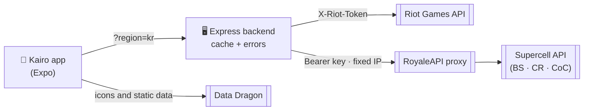

<div align="center">


# KAIRO

**Every match counts.**

[Español](README.md) · **English**

Stats for **League of Legends** (with **live game**), **Teamfight Tactics**, **Brawl Stars**, **Clash Royale**, **Clash of Clans**, **Dota 2**, **Fortnite**, **Apex Legends** and **PUBG** in one premium mobile app, built with React Native and Expo.

[](https://github.com/0scar07/Kairo/releases/latest)
[](https://github.com/0scar07/Kairo/actions/workflows/ci.yml)
[](https://stats.uptimerobot.com/3pSwWADClB)
[](https://scorecard.dev/viewer/?uri=github.com/0scar07/Kairo)

[](https://github.com/0scar07/Kairo/releases)
[](https://github.com/0scar07/Kairo/commits/main)


[Screenshots](#-screenshots) · [Features](#-features) · [Getting started](#-getting-started) · [Deploy](#%EF%B8%8F-deploy-to-the-cloud) · [Architecture](#%EF%B8%8F-architecture) · [Roadmap](#%EF%B8%8F-roadmap)

<br />


<sub>Screenshots rendered in a mobile browser against the real backend. On a phone, the highlights and haptics feel different. The app shown is in Spanish; it also speaks English, Português, Français and Deutsch.</sub>

<br />
<br />

### 🎬 App demo

<a href="https://0scar07.github.io/Kairo/demo/kairo-demo.mp4"></a>

<sub>The best of the demo, looping and muted. Below is the full 90-second tour with music, or <a href="docs/demo/kairo-demo.mp4">download it</a>.</sub>

<br />

https://github.com/user-attachments/assets/d742c1f1-c26e-4f44-955c-a063e2840adc

</div>

---

## 📲 Download

<div align="center">

<a href="https://github.com/0scar07/Kairo/releases/latest/download/Kairo.apk"></a>
&nbsp;
<a href="https://apps.obtainium.imranr.dev/redirect?r=obtainium://app/%7B%22id%22%3A%22com.camavingaaa.kairo%22%2C%22url%22%3A%22https%3A%2F%2Fgithub.com%2F0scar07%2FKairo%22%2C%22author%22%3A%220scar07%22%2C%22name%22%3A%22Kairo%22%7D"></a>

</div>

- **Direct APK:** the button above downloads `Kairo.apk` from the latest version (all of them are in [GitHub Releases](https://github.com/0scar07/Kairo/releases)). Android will ask you to allow installing apps from that source.
- **Obtainium:** add the repository with the button above and the app updates itself with every new version.
- **iPhone:** open <https://0scar07.github.io/Kairo/app/> in Safari, tap *Share* and then *Add to Home Screen*. It works like any other app, with no account or App Store (it is the web version, so some animations may differ).

---

## ✨ Features

### Riot Games

| | League of Legends | Teamfight Tactics |
|---|---|---|
| **Rank** | Solo/Duo and Flex with the **official emblem**, LP, win rate and tier color; the rank leads the header and each queue shows its **3 best win-rate champions** | Ranked, Double Up and Hyper Roll |
| **History** | Result, champion, queue, KDA, CS and damage (the **last 20** fill in the background); load more matches and filter by result and champion | Final placement 1–8, queue and duration |
| **Details** | All 10 players with items, **summoner spells and runes**; **gold difference minute by minute** and **item build order** | All 8 players with **traits and starred units** |
| **Summary** | Win rate and KDA **rings**; K/D/A totals, kill participation, damage, gold, CS and vision per minute; streak and most played champion; **per-champion table** | Average placement, top 4, wins and placement chart |
| **Mastery and rotation** | Top 3 champions with level and points, the weekly free rotation and maintenance notices for your region | (n/a) |
| **Live** | **Live game**: profile badge and a screen with the champion splash art, both teams, spells, runes, every player's rank, bans and a timer; a **"How to play against…"** shortcut to your lane opponent; **notifications** when a favorite starts a game and when it ends, with the result (Android) | (the API is not enabled yet) |
| **My profile** | Your Riot ID with badges and a KDA chart | Your Riot ID |

**Live game notifications (LoL, Android):** tap a favorite's bell and Kairo tells you when they start a game and when it ends, with the result, even with the app closed. With the app open, the alert shows up as a **fluid banner** (a glass drop that stretches into a capsule, with a liquid effect drawn with Skia) and a "N live" indicator. In Settings you choose what to be notified about, set quiet hours and send yourself a test. No accounts: each phone registers with its own token and secret.

**New in v1.5** (arrives over the air, no reinstall):
- **Matchups (LoL):** in Explore, pick your champion and your opponent and see the build that wins most against them, the keystone and summoner spells, the skill order (what to max first and the first 11 levels), their lane **counters**, and the opponent's abilities with cooldowns and damage type. Everything comes from Challenger games and every figure says how many games back it; when a matchup has few games, it shows the general build and says so. In **Live game**, the "How to play against X" shortcut opens your lane opponent.
- **LP progress:** tap Solo/Duo or Flex on a profile to open its 7-day, 30-day or season chart.
- **Every match, minute by minute:** match details show the gold difference and the item build order.
- **Follow a pro:** from Pros, their next official match and an alert 15 minutes before; the pros you follow show up in Favorites.
- **Suggested from the ladder:** with no favorites yet, Kairo suggests Challenger players from your region.
- **More polish:** iOS-style glass bars, loading in the exact shape of the profile and content that fades under the bars.

**More features (v1.4):**
- **Rank history (LoL):** the server takes a daily snapshot of the rank of your profile and your favorites, and the **LP progress** screen draws the chart (Solo/Duo and Flex). Riot does not provide history, so it starts with the first snapshot and grows every day.
- **Weekly summary:** on Sunday afternoon (your phone's time), a notification with your games, wins and LP of the week.
- **Progress alerts:** when a LoL favorite ranks up or down or enters promotion, and when a **Brawl Stars** or **Clash Royale** favorite beats their trophy record.
- **Compare two LoL players** head to head (rank, win rate, KDA, level, mastery, most played champion).
- **Explore (the search button in the bar):** your region's Challenger, Grandmaster or Master **ladder** (Solo/Duo or Flex), your **favorites in game right now** with a timer, the **pros**, **matchups**, Riot ID search and shortcuts to My profile and Compare.
- **Pro players:** LCK, LPL, LEC, LCS, LTA North and South, LLA, Worlds and MSI with each tournament's **standings**, each team's **roster** and each pro's profile (win rate, KDA, kill participation, gold and CS per minute, damage share and champions) per split. Data from lolesports.com.
- **Share a profile as an image** ready for social media (Android and native iPhone).
- **Offline profiles:** the app keeps the last thing you saw of each player and opens it without internet.
- **Updates without reinstalling:** screen and text changes arrive when you open the app; only native changes need a new APK.

TFT and LoL share **Riot ID** search with a **region** picker (LAN, LAS, NA, BR, EUW, EUNE, TR, KR, JP, OCE) that remembers the last one used. **Valorant** will come when Riot approves a *production key* (its match API requires it).

### Supercell

| | Brawl Stars | Clash Royale | Clash of Clans |
|---|---|---|---|
| **Profile** | Trophies, record, level and club | Trophies, record, level, clan and role | Town Hall, trophies, league and clan |
| **Progress** | 3v3, solo and duo wins; brawlers with power, rank and trophies | Wins, losses, win rate, 3-crown wins and Path of Legends | War, donations, heroes and Builder Base |
| **Matches** | Last 25 battles with brawler, mode, map and trophies | Last 30 battles with score and trophies; current deck with levels and elixir | (the API exposes no battle log) |

Searched by **`#TAG`**, no regions.

### Dota 2, Fortnite, Apex Legends and PUBG

| | Dota 2 | Fortnite | Apex Legends | PUBG |
|---|---|---|---|---|
| **Search** | Steam name (with a results list) or ID | Name + platform (Epic, PlayStation, Xbox) | Name + platform (PC, PlayStation, Xbox) | Name + platform (Steam, PlayStation, Xbox, Kakao) |
| **Rank** | **Official medal** with stars and world leaderboard position | (none) | Rank with its image, RP and level | Ranked: tier, points and K/D |
| **Stats** | Wins, losses, win rate and most played heroes | Per mode (overall, solo, duos, trios, squads): wins, K/D, top N, hours | Selected legend with its banner, kill and damage totals, online status | Per mode (FPP and TPP): wins, K/D, average damage, headshots, longest kill |
| **Matches** | Last 20 with hero, mode, K/D/A and duration | (the API only gives stats) | (the API only gives stats) | Last 8 with map, placement, kills and damage |

Dota 2 uses OpenDota (no key); Fortnite, Apex and PUBG need a free key. All of them are searched by name and each remembers its platform.

### Across the app

- **Five languages:** Español, English, Português, Français and Deutsch. Picked automatically from the device language or by hand in Settings; it changes the texts, LoL champion names (Data Dragon), server error messages and number formatting.
- **Multi-game:** nine games with one module each; the generic screens know none of them. Each game turns on only if the server has its key, and anything unavailable shows as "SOON" instead of failing.
- **Favorites** with cards (icon, rank or trophies in the game's color) and **recent searches**, the same for every game.
- **Visual identity:** an accent per game with a smooth transition, official game logos and icons, and **zero emojis** (custom SVG icons that take the game's color).
- **Animated loading screen** with real boot progress, staggered sections, skeletons, friendly empty states and errors with a retry button.
- **Haptics** and a subtle press scale; a floating *pill* navigation bar with the search button beside it; underlined tabs.

### Backend

- **The API key never ships in the app:** Riot and Supercell keys live on the server (`server/.env` or hosting variables).
- **Cache** with request deduplication (finished matches 1 h), an **outgoing queue to Riot** that respects the key's rate limit, per-IP request limits and translated errors.
- **Enabled games detection:** a periodic probe checks which APIs your key allows and publishes them in `/health`.
- **Cloud ready:** Dockerfile, `render.yaml`, graceful shutdown and automated tests (`npm test`) with CI on GitHub Actions.

## 📸 Screenshots

<table>
  <tr>
    <td align="center"><br /><sub><b>Home and rotation</b></sub></td>
    <td align="center"><br /><sub><b>LoL profile</b></sub></td>
    <td align="center"><br /><sub><b>Live game</b></sub></td>
    <td align="center"><br /><sub><b>Mastery</b></sub></td>
  </tr>
  <tr>
    <td align="center"><br /><sub><b>Dota 2</b></sub></td>
    <td align="center"><br /><sub><b>Brawl Stars</b></sub></td>
    <td align="center"><br /><sub><b>Clash Royale</b></sub></td>
    <td align="center"><br /><sub><b>Settings and languages</b></sub></td>
  </tr>
</table>

More screenshots (TFT, Supercell, Dota 2, other languages, favorites) are in the [Spanish README](README.md#-capturas).

## 🧱 Stack

| Layer | Technology |
|------|------------|
| App | React Native 0.86 · Expo SDK 57 · React Navigation 7 |
| Animation | Reanimated 4 · Skia (`@shopify/react-native-skia`, liquid banner) · SVG (`react-native-svg`) · `expo-haptics` |
| Design | Custom *token* system (`src/theme`) · Sora + Inter (`@expo-google-fonts`) |
| Data | Express 5 backend · Riot API · Supercell API (through a fixed-IP proxy) · OpenDota · Fortnite-API · Apex Legends Status · PUBG API · Data Dragon · Brawlify · LoL Esports |
| Notifications | `expo-notifications` + Expo Push (FCM on Android) · live game watcher on the backend · Postgres (Neon) for devices, LP history and Challenger builds |
| Storage | AsyncStorage (favorites, recents, preferences) |

## 🏗️ Architecture



- **API keys (Riot and Supercell) never ship in the app:** they only live in `server/.env` or in the hosting variables.
- The backend **caches** (finished matches 1 h) and translates Riot errors.
- Generic screens **know no game**: everything game-specific comes from `src/games/`.

More detail, sequence diagrams and decisions (in Spanish) in [docs/ARQUITECTURA.md](docs/ARQUITECTURA.md).

## 🚀 Getting started

You need **Node 20+** and a key from <https://developer.riotgames.com> (development keys expire every 24 h). For Brawl Stars, Clash Royale and Clash of Clans, optionally, a key from each Supercell portal.

### 1. Backend

```bash
cd server
npm install
cp .env.example .env        # and set your RIOT_API_KEY (and the Supercell ones, if you want)
npm start                   # http://localhost:3000  ·  check /health
```

### 2. App

```bash
npm install
npx expo start
```

On a physical device, point the app to your PC's IP (same Wi-Fi network):

```bash
EXPO_PUBLIC_API_URL=http://192.168.1.8:3000 npx expo start
```

**Expo Go** is the quickest way to try it: scan the QR from `npm run phone` (same as `npx expo start --offline`, which avoids asking for an Expo login).

## ☁️ Deploy to the cloud

For the app to work **without your PC on**, the backend has to be online. Favorites and preferences are stored on the phone; a database is only needed for notifications, LP history and Challenger builds (`DATABASE_URL`, for example Neon). Without it, the server uses a local file, which Render's free plan wipes on restart.

The repo includes [`render.yaml`](render.yaml) and a [`Dockerfile`](server/Dockerfile) (Render, Railway, Fly.io…). With Render:

1. **New → Blueprint** on <https://render.com>, pick this repository.
2. Paste your `RIOT_API_KEY` when asked and press **Apply**.
3. Check `https://YOUR-URL.onrender.com/health` and set that URL in `EXPO_PUBLIC_API_URL`.

> ⚠️ Riot development keys **expire after 24 h**: a permanent backend needs a *Personal* or *Production API Key*.

All the server variables, every backend route and the troubleshooting table are in the [Spanish README](README.md#%EF%B8%8F-configuración) and in [docs/DESPLIEGUE.md](docs/DESPLIEGUE.md).

## 🗺️ Roadmap

- [x] Full LoL and TFT, with favorites, recents and regions
- [x] Design system, animated loading screen and micro-interactions
- [x] Backend in the cloud (Render) with cache, rate limits, CORS and Docker
- [ ] Publish with a Riot *Production API Key*
- [ ] Valorant (needs Riot's approval)
- [x] Offline mode with the last seen profile
- [x] Rank change and live game notifications
- [x] Mastery, free rotation and server status (LoL)
- [x] Brawl Stars, Clash Royale and Clash of Clans (Supercell API)
- [x] Dota 2, Fortnite, Apex Legends and PUBG (search by name and platform)
- [x] Compare two players
- [x] Ladder, pro players and following a pro
- [x] LP progress and match details minute by minute
- [x] Matchups: build, runes, skill order and counters per champion matchup

Everything already released, version by version, is in [CHANGELOG.md](CHANGELOG.md) (in Spanish).

## ⭐ Stars

If Kairo is useful to you, a star helps more people find it (and gets it into the Obtainium catalog).

<a href="https://star-history.com/#0scar07/Kairo&Date"><picture><source media="(prefers-color-scheme: dark)" srcset="https://api.star-history.com/svg?repos=0scar07/kairo&type=Date&theme=dark" /></picture></a>

## 🤝 Contributing

Read [CONTRIBUTING.md](CONTRIBUTING.md) and the [code of conduct](CODE_OF_CONDUCT.md) (both in Spanish; issues and PRs in English are welcome too). To report a vulnerability or an exposed key, use [Report a vulnerability](https://github.com/0scar07/Kairo/security/advisories/new) — never a public issue.

## 📄 License

[MIT](LICENSE).

## ⚖️ Legal

Kairo isn't endorsed by Riot Games and doesn't reflect the views or opinions of Riot Games or anyone officially involved in producing or managing Riot Games properties. Riot Games, and all associated properties are trademarks or registered trademarks of Riot Games, Inc.

Dota 2 is a trademark of Valve Corporation, Fortnite of Epic Games, Apex Legends of Electronic Arts and PUBG of KRAFTON, Inc.; Kairo is not affiliated with or endorsed by them.

This material is unofficial and is not endorsed by Supercell. For more information see Supercell's [Fan Content Policy](https://supercell.com/en/fan-content-policy/). Brawl Stars, Clash Royale and Clash of Clans are trademarks of Supercell.
