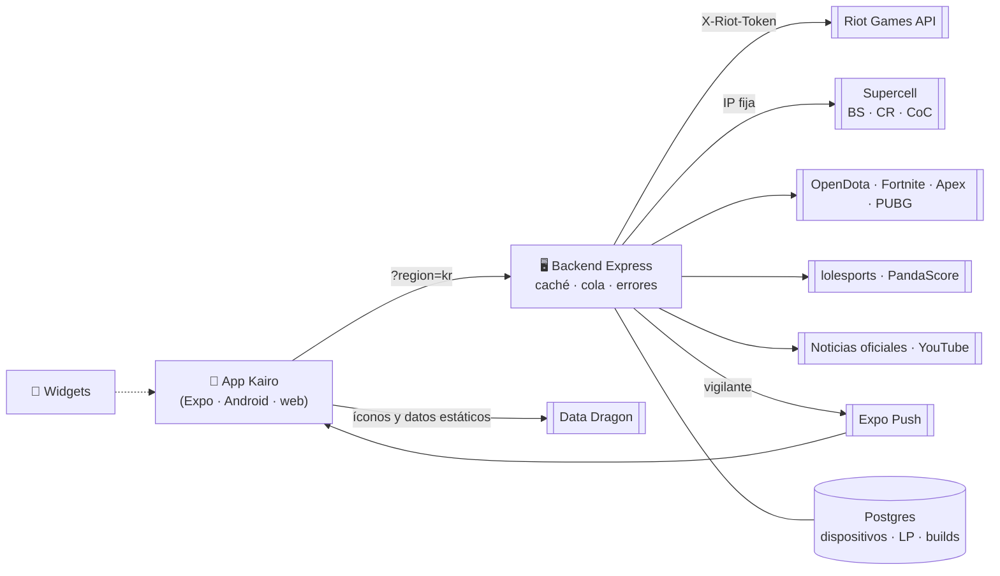

<div align="center">


# KAIRO

### Cada partida cuenta.

**Español** · [English](README.en.md)

Tus estadísticas de **11 juegos** en una sola app móvil premium: rango, historial, **partida en vivo**, esports, noticias, clips y widgets.<br />
Gratis, sin cuentas, sin anuncios y con las API keys guardadas en el servidor, nunca en el celular.

[](https://github.com/0scar07/Kairo/releases/latest)
[](https://github.com/0scar07/Kairo/releases)
[](https://github.com/0scar07/Kairo/actions/workflows/ci.yml)
[](https://stats.uptimerobot.com/3pSwWADClB)
[](https://scorecard.dev/viewer/?uri=github.com/0scar07/Kairo)
[](https://github.com/0scar07/Kairo/commits/main)


[Descargar](#-descargar) · [Lo nuevo](#-lo-nuevo) · [Qué trae](#-qué-trae) · [Capturas](#-capturas) · [Arquitectura](#%EF%B8%8F-arquitectura) · [Puesta en marcha](#-puesta-en-marcha) · [API](#-api-del-backend) · [Roadmap](#%EF%B8%8F-roadmap)

<br />


<sub>Capturas renderizadas en un navegador móvil contra el backend real. En un celular los brillos y la háptica se ven distintos.</sub>

<br />
<br />

### 🎬 Demostración

<a href="https://0scar07.github.io/Kairo/demo/kairo-demo.mp4"></a>

<sub>Lo mejor de la demostración, en bucle y sin sonido. Debajo está el recorrido completo de 90 segundos con música, o <a href="docs/demo/kairo-demo.mp4">descárgalo</a>.</sub>

<br />

https://github.com/user-attachments/assets/d742c1f1-c26e-4f44-955c-a063e2840adc

</div>

---

## 📲 Descargar

<div align="center">

<a href="https://github.com/0scar07/Kairo/releases/latest/download/Kairo.apk"></a>
&nbsp;
<a href="https://apps.obtainium.imranr.dev/redirect?r=obtainium://app/%7B%22id%22%3A%22com.camavingaaa.kairo%22%2C%22url%22%3A%22https%3A%2F%2Fgithub.com%2F0scar07%2FKairo%22%2C%22author%22%3A%220scar07%22%2C%22name%22%3A%22Kairo%22%7D"></a>

</div>

| Dónde | Cómo |
|---|---|
| **Android (APK)** | El botón verde baja `Kairo.apk` de la última versión ([todas las versiones](https://github.com/0scar07/Kairo/releases)). Android pedirá permitir instalar apps desde esa fuente. Se instala encima de la anterior sin perder nada. |
| **Android (Obtainium)** | Añade el repositorio con el otro botón y la app se actualiza sola con cada versión nueva. |
| **iPhone** | Abre <https://0scar07.github.io/Kairo/app/> en Safari → *Compartir* → *Añadir a pantalla de inicio*. Queda como una app más, sin cuenta ni App Store (es la versión web, así que algunas animaciones pueden variar). |

> [!TIP]
> Los cambios de pantallas y textos llegan **por aire** al abrir la app, sin reinstalar. Solo lo nativo (como los widgets) pide un APK nuevo. Todo está en el [CHANGELOG](CHANGELOG.md).

---

## 🆕 Lo nuevo

<table>
<tr>
<td width="50%" valign="top">

**🎯 Objetivo de la semana (LoL)**<br />
«Sube 50 LP», «Gana 5 de 10» o «KDA de 3 o más», con barra que se llena con brillo, los días jugados y confeti al cumplirlo.

**📖 Tu semana, tipo Wrapped**<br />
Una historia de 4 páginas (LP, tu campeón, tu mejor partida y el resumen) que se pasa sola y se comparte como imagen.

**⚔️ Comparar con pros**<br />
Cada jugador sobre el arte de su campeón, barras dorado contra azul, quién va por delante y rivales de un toque: Faker y el top 5 de Challenger.

</td>
<td width="50%" valign="top">

**📺 Clips → Siguiendo**<br />
Sigue hasta 12 pros y streamers por su @ o enlace de YouTube y mira sus Shorts en el visor tipo TikTok.

**🔴 Modo espectador (Valorant)**<br />
El partido en vivo se actualiza solo cada 30 s, el mapa en juego late y «Lo último» cuenta qué pasó. Sigue a un equipo y te avisa 15 min antes.

**🔔 Avisos de parches · 🌍 9 idiomas**<br />
Notificación cuando sale un parche de los juegos que elijas. Y ahora también en italiano, turco, polaco y coreano.

</td>
</tr>
</table>

### 🧩 Widgets en la pantalla de inicio (Android)

<div align="center">

&nbsp;

&nbsp;

</div>

Tu **rango Solo/Dúo** con LP, lo de la semana y las últimas 5; el **próximo partido de Valorant** de tu equipo; y **quién de tus favoritos está en partida**. Mantén pulsado el fondo de pantalla → *Widgets* → *Kairo*. Tocar uno abre su pantalla en la app.

---

## ✨ Qué trae

<table>
<tr>
<td width="33%" valign="top">

#### 📊 Estadísticas
- Rango con **emblema oficial**, LP y winrate
- Historial con filtros y **detalle minuto a minuto**
- **Progreso de LP** de 7 días, 30 días o la temporada
- **Comparar** dos jugadores
- **Perfiles sin conexión**

</td>
<td width="33%" valign="top">

#### 🔴 En vivo
- **Partida en vivo** de LoL con runas, rangos y baneos
- **Notificaciones** al empezar y terminar, con el resultado
- **Enfrentamientos**: build, runas y counters por cruce
- **Pros**: plantillas, estadísticas y su próximo partido
- Esports de Valorant y Wild Rift

</td>
<td width="33%" valign="top">

#### 🧭 Explorar
- **Noticias** al estilo Netflix y notas del parche dentro de la app
- **Clips** tipo TikTok con Shorts oficiales y de quien sigas
- **Ranking** Challenger, GM y Master
- Tier list de **Wild Rift**
- Compartir perfil e historias como imagen

</td>
</tr>
</table>

### 🎮 Juegos

| Juego | Búsqueda | Lo que ves |
|---|---|---|
|  **League of Legends** | Riot ID + región | Rango, historial, maestría, rotación, **partida en vivo**, progreso de LP, enfrentamientos, pros, objetivo y Tu semana |
|  **Teamfight Tactics** | Riot ID + región | Ranked, Double Up, Hyper Roll, posiciones y los 8 jugadores con rasgos y unidades |
|  **Brawl Stars** | `#TAG` | Trofeos, brawlers con poder y rango, últimas 25 batallas, récords |
|  **Clash Royale** | `#TAG` | Trofeos, Senda de leyendas, mazo actual con elixir, últimas 30 batallas |
|  **Clash of Clans** | `#TAG` | Ayuntamiento, liga, guerra, donaciones, héroes y base del constructor |
|  **Dota 2** | Nombre de Steam o ID | Medalla oficial, puesto mundial, héroes y últimas 20 partidas |
|  **Fortnite** | Nombre + plataforma | Por modo: victorias, K/D, top N y horas |
|  **Apex Legends** | Nombre + plataforma | Rango con RP, leyenda con su banner y estado en línea |
|  **PUBG** | Nombre + plataforma | FPP y TPP, clasificatoria y últimas 8 partidas |
|  **Wild Rift** | — | Tier list S+ a D por carril y rango, ficha y comparador de campeones, Mis mains, los que suben y bajan |
|  **Valorant** | — | Esports: último campeón, partido en vivo, calendario, resultados, torneos y equipos que sigues |

<sub>Wild Rift no tiene API pública y los perfiles de Valorant esperan la aprobación de Riot, así que esos dos van directo a lo que sí hay.</sub>

<details>
<summary><b>Ver todas las funciones, juego por juego</b></summary>

### Riot Games

| | League of Legends | Teamfight Tactics |
|---|---|---|
| **Rango** | Solo/Dúo y Flex con **emblema oficial**, LP, winrate y color del tier; cada cola muestra sus **3 campeones con mejor winrate**. Tocar una cola abre su **gráfico de LP** | Ranked, Double Up y Hyper Roll |
| **Historial** | Resultado, campeón, cola, KDA, CS y daño (las **últimas 20** se completan en segundo plano); carga más y filtra por resultado y campeón | Posición final 1–8, cola y duración |
| **Detalle** | Los 10 jugadores con objetos, **hechizos y runas**; **diferencia de oro minuto a minuto** y **orden de compra** | Los 8 jugadores con **rasgos y unidades con estrellas** |
| **Resumen** | **Anillos** de winrate y KDA; totales, participación en kills, daño, oro, CS y visión por minuto; racha, campeón más jugado y **tabla por campeón** | Posición promedio, top 4, victorias y gráfico de posiciones |
| **Maestría y rotación** | Top 3 de campeones, rotación gratuita y aviso de mantenimiento de tu región | (no aplica) |
| **En vivo** | Splash art del campeón, los dos equipos, hechizos, runas, rango de cada jugador, baneos y cronómetro; atajo **«Cómo jugar contra…»** a tu rival de línea | (la API aún no está habilitada) |
| **Mi perfil** | Tu Riot ID con insignias, gráfico de KDA, **objetivo de la semana** y **Tu semana** | Tu Riot ID |

- **Enfrentamientos:** eliges tu campeón y tu rival y ves la build que más gana contra él, la runa principal, los hechizos, el orden de habilidades (los primeros 11 niveles), sus **counters** en la línea y las habilidades del rival con su enfriamiento y tipo de daño. Todo sale de partidas de Challenger y cada dato dice cuántas partidas lo respaldan.
- **Historial de rango:** el servidor guarda una foto diaria del rango de tu perfil y de tus favoritos (Riot no da historial, así que se llena desde la primera foto).
- **Resumen semanal:** el domingo por la tarde, una notificación con tus partidas, victorias y LP.
- **Jugadores profesionales:** LCK, LPL, LEC, LCS, LTA Norte y Sur, LLA, Mundial y MSI con clasificación, plantillas y el perfil de cada pro por split. **Sigue a un pro** y te avisa 15 minutos antes de su partida.
- **Ranking** Challenger, Gran Maestro o Maestro de tu región (Solo/Dúo o Flex) y **sugeridos** si aún no tienes favoritos.

LoL y TFT comparten la búsqueda por **Riot ID** con selector de **región** (LAN, LAS, NA, BR, EUW, EUNE, TR, KR, JP, OCE) que recuerda la última usada.

### Supercell

| | Brawl Stars | Clash Royale | Clash of Clans |
|---|---|---|---|
| **Perfil** | Trofeos, récord, nivel y club | Trofeos, récord, nivel, clan y rol | Ayuntamiento, trofeos, liga y clan |
| **Progreso** | Victorias 3v3, solo y dúo; brawlers con poder, rango y trofeos | Victorias, derrotas, winrate, 3 coronas y Senda de leyendas | Guerra, donaciones, héroes y base del constructor |
| **Partidas** | Últimas 25 batallas con brawler, modo, mapa y trofeos | Últimas 30 batallas con marcador y trofeos; mazo actual con nivel y elixir | (la API no expone registro de batallas) |

Se buscan por **`#TAG`**, no tienen regiones y avisan cuando un favorito **bate su récord de trofeos**.

### Dota 2, Fortnite, Apex Legends y PUBG

| | Dota 2 | Fortnite | Apex Legends | PUBG |
|---|---|---|---|---|
| **Búsqueda** | Nombre de Steam (con lista) o ID | Nombre + Epic, PlayStation, Xbox | Nombre + PC, PlayStation, Xbox | Nombre + Steam, PlayStation, Xbox, Kakao |
| **Rango** | **Medalla oficial** con estrellas y puesto mundial | (no tiene) | Rango con su imagen, RP y nivel | Tier, puntos y K/D |
| **Estadísticas** | Victorias, derrotas, winrate y héroes | Por modo: victorias, K/D, top N, horas | Leyenda con su banner, bajas, daño y estado | FPP y TPP: victorias, K/D, daño medio, headshots |
| **Partidas** | Últimas 20 con héroe, modo, K/D/A y duración | (solo estadísticas) | (solo estadísticas) | Últimas 8 con mapa, puesto, bajas y daño |

### Wild Rift y Valorant

| | Wild Rift | Valorant |
|---|---|---|
| **Inicio** | Arte oficial del último parche, tier list, **Mis mains**, top del parche, **los que suben y bajan hoy** y notas del parche | Un agente distinto cada día, el **último campeón** (o el partido en vivo), la **cuenta atrás** y los próximos torneos con su premio |
| **Tier list / Calendario** | Tiers S+ a D por carril y rango (Diamante a Leyenda); se ordena por tier, victorias, elección o baneo y **se comparte como imagen** | Próximos por día, resultados y torneos |
| **Detalle** | Ficha con anillos de victorias, elección y baneo y su winrate en cada rango | **Modo espectador**: se actualiza cada 30 s, mapa en juego, «Lo último» y botón **Seguir** por equipo |
| **Datos** | Servidor público de China (una vez al día) y web oficial | PandaScore (`PANDASCORE_TOKEN`, gratis) |

Wild Rift no publica builds ni counters en ninguna fuente pública, así que la app no los inventa.

### En toda la app

- **Nueve idiomas:** español, English, Português, Français, Deutsch, Italiano, Türkçe, Polski y 한국어. Se elige solo según el dispositivo o a mano en Ajustes, y traduce también los nombres de campeones (Data Dragon), los errores del servidor y el formato de los números.
- **Notificaciones** por canal: partida en vivo de un favorito, cambios de rango, récords, parches nuevos, partidos de equipos de Valorant y resumen semanal, con horario silencioso. Con la app abierta aparecen como un **banner líquido** dibujado con Skia.
- **Multijuego:** un módulo por juego; las pantallas genéricas no conocen ninguno. Si el servidor no tiene la key de un juego, aparece como «PRONTO» en vez de dar errores.
- **Diseño propio:** acento por juego, logos con su degradado de marca, **Liquid Glass** al estilo iOS, títulos grandes que se compactan, carga con la forma exacta del perfil y **cero emojis** (íconos SVG propios).
- **Accesibilidad:** lectores de pantalla, «Reducir movimiento» y «Reducir transparencia».

</details>

---

## 📸 Capturas

<table>
  <tr>
    <td align="center"><br /><sub><b>Inicio y rotación</b></sub></td>
    <td align="center"><br /><sub><b>Perfil de LoL</b></sub></td>
    <td align="center"><br /><sub><b>Partida en vivo</b></sub></td>
    <td align="center"><br /><sub><b>Maestría</b></sub></td>
  </tr>
  <tr>
    <td align="center"><br /><sub><b>Dota 2</b></sub></td>
    <td align="center"><br /><sub><b>Brawl Stars</b></sub></td>
    <td align="center"><br /><sub><b>Clash Royale</b></sub></td>
    <td align="center"><br /><sub><b>Ajustes e idiomas</b></sub></td>
  </tr>
</table>

<details>
<summary><b>Ver todas las capturas</b></summary>

**League of Legends**

<p>
  
  
  
  
  
  
  
  
  
  
  
  
</p>

**Supercell**

<p>
  
  
  
</p>

**Dota 2 y otros idiomas**

<p>
  
  
  
</p>

**Teamfight Tactics**

<p>
  
  
  
  
</p>

**Favoritos y recientes**

<p>
  
  
  
</p>

<sub>Datos reales de las APIs de cada juego. Fortnite, Apex Legends y PUBG aún no tienen captura. Las de TFT son anteriores al rediseño de íconos. * El aviso de mantenimiento se simuló para enseñar el diseño.</sub>

</details>

---

## 🏗️ Arquitectura



- **Las API keys nunca van en la app:** viven solo en `server/.env` o en las variables del hosting.
- **Caché** con deduplicación (partidas terminadas 1 h), **cola de salida hacia Riot** que respeta el cupo de la key, límite por IP y errores con código que la app traduce.
- Un **vigilante** revisa a los favoritos cada 2 minutos y manda los avisos de partida en vivo, rango, récords y parches.
- Las pantallas genéricas **no conocen ningún juego**: leen todo de `src/games/`.

Más detalle, diagramas de secuencia y decisiones en [docs/ARQUITECTURA.md](docs/ARQUITECTURA.md).

### 🧱 Stack

| Capa | Tecnología |
|------|------------|
| App | React Native 0.86 · Expo SDK 57 · React Navigation 7 · EAS Update (por aire) |
| Animación | Reanimated 4 · Skia · `react-native-svg` · `expo-haptics` |
| Widgets | `react-native-android-widget` |
| Diseño | *Tokens* propios (`src/theme`) · Sora + Inter |
| Backend | Node 20 · Express 5 · Postgres (Neon) · Docker · Render |
| Datos | Riot · Supercell (proxy RoyaleAPI) · OpenDota · Fortnite-API · Apex Legends Status · PUBG · Data Dragon · Brawlify · lolesports.com · PandaScore · Wild Rift (servidor de China) · valorant-api.com · YouTube |
| Notificaciones | `expo-notifications` + Expo Push (FCM) · Web Push para Kairo Web |

---

## 🚀 Puesta en marcha

Necesitas **Node 20+** y una key de <https://developer.riotgames.com> (las de desarrollo caducan cada 24 h). Las de los demás juegos son opcionales: cada uno se activa al poner la suya.

```bash
# 1. Backend
cd server
npm install
cp .env.example .env        # pon tu RIOT_API_KEY (y, si quieres, las demás)
npm start                   # http://localhost:3000 · comprueba /health

# 2. App (en otra terminal, desde la raíz)
npm install
npx expo start
```

En un dispositivo físico, apunta la app a la IP de tu PC (misma red Wi-Fi):

```bash
EXPO_PUBLIC_API_URL=http://192.168.1.8:3000 npx expo start
```

<details>
<summary><b>Probar en el celular (Expo Go o APK de prueba)</b></summary>

- **Expo Go** *(lo más rápido)*: escanea el QR de `npm run phone` (equivale a `npx expo start --offline`, que evita pedir sesión de Expo). En Expo Go no se ven el splash nativo ni los widgets.
- **APK de prueba con EAS**:
  ```bash
  npm install -g eas-cli
  eas login
  eas build -p android --profile preview
  ```
  Edita `EXPO_PUBLIC_API_URL` en el perfil `preview` de [eas.json](eas.json): el APK solo llega a un backend accesible desde el celular.

> **HTTP en el APK:** `app.config.js` habilita el tráfico HTTP sin cifrar solo cuando `EXPO_PUBLIC_API_URL` empieza por `http://` (pruebas locales). Con un backend `https://` queda desactivado.

</details>

### ☁️ Desplegar en la nube

Para que la app funcione **sin tu PC encendida**, el backend tiene que estar en internet. El repo trae [`render.yaml`](render.yaml) y un [`Dockerfile`](server/Dockerfile) (Render, Railway, Fly.io…):

1. **New → Blueprint** en <https://render.com> y elige este repositorio.
2. Pega tu `RIOT_API_KEY` cuando la pida y pulsa **Apply**.
3. Prueba `https://TU-URL.onrender.com/health` y pon esa URL en `EXPO_PUBLIC_API_URL`.

Los favoritos y preferencias viven en el celular; la base de datos (`DATABASE_URL`, por ejemplo Neon) solo hace falta para notificaciones, historial de LP y builds. Sin ella el servidor usa un archivo local, que Render gratis borra al reiniciar.

> [!WARNING]
> Las keys de desarrollo de Riot **caducan a las 24 h**: para un backend permanente necesitas una *Personal* o *Production API Key*.

Guía completa (plan gratuito que se duerme, Railway/Fly, publicar un APK, seguridad): [docs/DESPLIEGUE.md](docs/DESPLIEGUE.md).

<details>
<summary><b>⚙️ Variables de entorno</b></summary>

`server/.env`

| Variable | Descripción |
|----------|-------------|
| `RIOT_API_KEY` | Tu key de Riot. **Obligatoria**: si falta, el servidor no arranca |
| `PORT` | Puerto del backend (por defecto `3000`) |
| `DEFAULT_REGION` | Región si la app no envía `?region=` (por defecto `la1`) |
| `RATE_LIMIT_PER_MIN` | Peticiones por minuto y por IP (por defecto `240`) |
| `CORS_ORIGINS` | Orígenes web permitidos, separados por comas (vacío = abierto) |
| `TRUST_PROXY` | Proxies delante del servidor (por defecto `1` en producción) |
| `RIOT_RATE_LIMITS` | Cupo hacia Riot, `peticiones:segundos` (por defecto `18:1,95:120`) |
| `PROBE_RIOT_ID` | Cuenta pública para detectar qué juegos habilita la key (`Nombre#TAG@region`) |
| `BRAWLSTARS_API_KEY` · `CLASHROYALE_API_KEY` · `CLASHOFCLANS_API_KEY` | Keys de Supercell (opcionales). Permite la IP `45.79.218.79` al crearlas |
| `*_API_BASE` | Otra URL base para esos juegos (por defecto los proxies de RoyaleAPI, que dan una IP fija) |
| `FORTNITE_API_KEY` · `APEX_API_KEY` · `PUBG_API_KEY` | Keys gratuitas de Fortnite-API, Apex Legends Status y PUBG (opcionales) |
| `OPENDOTA_API_KEY` | Opcional: Dota 2 funciona sin key; con ella suben los límites |
| `PANDASCORE_TOKEN` | Token gratuito de [PandaScore](https://pandascore.co) para los esports de Wild Rift y Valorant |
| `YOUTUBE_API_KEY` | Opcional: API de YouTube para los Clips y para seguir canales por @ (sin ella se usan los feeds públicos) |
| `LOLESPORTS_API_KEY` | Opcional: key de lolesports.com (por defecto la pública de su web) |
| `DATABASE_URL` | Postgres para dispositivos, historial de LP y builds (sin ella, un archivo JSON local) |
| `WATCHER_ENABLED` · `WATCH_INTERVAL_MS` · `WATCH_MAX_PER_TICK` | Vigilante: encendido (sí), cada cuánto revisa (`120000` ms) y cuántos jugadores por vuelta (`40`) |
| `BUILDS_ENABLED` | `false` apaga la recolección de builds de Challenger (útil en local) |
| `MAX_DEVICES` | Tope de dispositivos para notificaciones (por defecto `5000`) |
| `EXPO_ACCESS_TOKEN` | Opcional: token de Expo si activas la seguridad de envío |
| `WEBPUSH_PUBLIC_KEY` · `WEBPUSH_PRIVATE_KEY` · `WEBPUSH_SUBJECT` | Opcionales: avisos de Kairo Web (`npx web-push generate-vapid-keys`) |
| `ART_SECRET` · `PUBLIC_BASE_URL` | Opcionales: firma y URL pública de las imágenes de las notificaciones |

App: `EXPO_PUBLIC_API_URL` es la URL del backend (por defecto `http://192.168.1.8:3000`).

</details>

---

## 🔌 API del backend

Todas las rutas de Riot aceptan `?region=la1 · la2 · na1 · br1 · euw1 · eun1 · tr1 · kr · jp1 · oc1 …`. Las que traen textos aceptan `?lang=` o `?hl=` con el idioma.

<details>
<summary><b>League of Legends y TFT</b></summary>

| Ruta | Descripción |
|------|-------------|
| `GET /health` | Estado, regiones, cola hacia Riot y **qué juegos habilita la key** (`games`) |
| `GET /{lol\|tft}/account/:gameName/:tagLine` | Cuenta Riot (PUUID) |
| `GET /{lol\|tft}/summoner/:puuid` | Perfil de invocador (ícono, nivel) |
| `GET /{lol\|tft}/ranked/:puuid` | Rangos del jugador |
| `GET /{lol\|tft}/matches/:puuid?start=0&count=10` | IDs de partidas (máx. 20 por página) |
| `GET /{lol\|tft}/match/:matchId` | Detalle de una partida |
| `GET /lol/mastery/:puuid?count=3` | Maestría: top de campeones y puntaje total |
| `GET /lol/rotation` | Rotación semanal gratuita |
| `GET /lol/status` | Mantenimientos e incidencias de la región |
| `GET /lol/live/:puuid` | Partida en curso con el rango de cada jugador (`{ inGame: false }` si no juega) |
| `GET /lol/live/:puuid/insights` | La maestría de cada jugador con el campeón que juega |
| `GET /lol/match/:matchId/timeline` | Oro, experiencia y farmeo por minuto, objetivos y orden de compra |
| `GET /lol/history/:puuid` · `POST /lol/history/touch` | Historial diario de rango (30 días) |
| `GET /lol/builds` · `GET /lol/builds/:championId` | Builds de Challenger del parche |
| `GET /lol/builds/matchups?position=` · `/:championId/opponents` · `/:championId/vs/:enemyId` | Enfrentamientos: cruces por línea, rivales frecuentes y el resumen de un cruce |
| `GET /lol/leaderboard?region=&tier=&queue=&start=&limit=` | Challenger, Gran Maestro o Maestro paginado (máx. 50; `X-Total-Count`). Lo usa también [Kairo Web](https://github.com/0scar07/kairo-web) |

Las rutas antiguas sin prefijo (`/account`, `/summoner`, `/ranked`, `/matches`, `/match`) siguen funcionando como alias de `/lol/…`.

</details>

<details>
<summary><b>Esports de LoL</b></summary>

| Ruta | Descripción |
|---|---|
| `GET /esports/leagues` | LCK, LPL, LEC, LCS, LTA Norte y Sur, LLA, Mundial y MSI |
| `GET /esports/leagues/:slug?tournamentId=` | Torneos de la liga y la clasificación del elegido |
| `GET /esports/teams/:slug` | Equipo con su plantilla |
| `GET /esports/teams/:slug/stats?tournamentId=` | Estadísticas de cada jugador en el torneo |
| `GET /esports/teams/:slug/next` | Próxima partida oficial del equipo |

</details>

<details>
<summary><b>Supercell, Dota 2, Fortnite, Apex y PUBG</b></summary>

| Ruta | Descripción |
|------|-------------|
| `GET /{brawlstars, clashroyale, clashofclans}/player/:tag` | Perfil del jugador (el tag con o sin `#`) |
| `GET /{brawlstars, clashroyale}/battles/:tag` | Últimas batallas (`{ items }`) |
| `GET /{brawlstars, clashroyale, clashofclans}/top?limit=10` | Mejores jugadores del mundo |
| `GET /brawlstars/club/:tag` · `/brawlers` · `/events` | Club, brawlers y eventos activos |
| `GET /dota2/search?q=` · `/player/:id` · `/heroes` · `/match/:id` · `/items` · `/herostats` | Búsqueda, perfil, héroes, partidas y objetos |
| `GET /fortnite/player/:name?platform=epic\|psn\|xbl` | Estadísticas por modo |
| `GET /apex/player/:name?platform=PC\|PS4\|X1` | Rango, leyenda, totales y estado |
| `GET /pubg/player/:name?platform=steam\|psn\|xbox\|kakao` | Temporada, clasificatoria y últimas partidas |

</details>

<details>
<summary><b>Wild Rift, Valorant, Noticias y Clips</b></summary>

| Ruta | Descripción |
|------|-------------|
| `GET /wildrift/meta?rank=diamond\|master\|challenger\|legend` | Tier list por carril del rango elegido |
| `GET /wildrift/champion/:heroId` | Un campeón en cada rango y carril |
| `GET /wildrift/news?lang=` | Actualizaciones de la web oficial (las notas del parche llevan `patch: true`) |
| `GET /wildrift/esports` · `GET /valorant/esports` | En vivo, próximos, resultados y torneos |
| `GET /valorant/match/:id` | Detalle de un partido (en vivo se renueva cada 20 s) |
| `GET /news?lang=es\|en\|pt\|fr\|de\|it\|tr\|pl\|ko` | Lo último de LoL, TFT, Valorant, Wild Rift, Dota 2, Apex, PUBG y Fortnite |
| `GET /news/article?game=lol\|tft\|valorant\|wildrift&path=` | Un artículo de Riot (notas del parche) en secciones, campeones y cambios |
| `GET /clips` | Shorts de los canales oficiales de YouTube de cada juego |
| `GET /clips/channel?c=` | Busca un canal por @, enlace o ID (por @ hace falta `YOUTUBE_API_KEY`) |
| `GET /clips/suggested` | Pros y streamers sugeridos para seguir |
| `GET /clips/following?c=UC…,UC…&g=lol,…` | Shorts de los canales que sigues (hasta 12) |

</details>

<details>
<summary><b>Notificaciones y sincronización</b></summary>

Sin cuentas: cada celular se registra con su token y un secreto propio.

| Ruta | Descripción |
|------|-------------|
| `POST /devices` · `GET /devices/me` · `PUT /devices/me/{favorites, settings, token, webpush}` · `POST /devices/me/test` · `DELETE /devices/me` | Registro, favoritos vigilados, ajustes de avisos (incluidos los parches por juego), prueba y baja |
| `POST /sync` · `GET /sync/:code` · `PUT /sync/:code` | Favoritos sincronizados de Kairo Web con un código privado |
| `GET /art/banner.png` | Imagen de las notificaciones (solo URLs firmadas por el servidor) |

</details>

---

## 🧑‍💻 Para desarrolladores

### Estructura

```
index.js                 entrada: registra los widgets y la app
server/                  backend Express + Dockerfile + pruebas (node --test)
  lib/                   clientes de cada API, caché, cola, vigilante, rastreadores (rango, trofeos, parches) y push
  routes/                una ruta por juego, builds, esports, noticias, clips, dispositivos y sync
src/
  games/                 un módulo por juego (lol/, tft/, valorant/, wildrift/…) + registro
  screens/               Inicio, Favoritos, Ajustes, Perfil, Mi perfil, Búsqueda, Carga
  components/            componentes genéricos y ui/ (Glass, Sheet, Confetti…)
  news/ · clips/         Noticias PRO y Clips tipo TikTok
  notifications/         avisos de partida, parches y equipos, y sus rutas al tocarlos
  widget/                widgets de Android y sus datos
  i18n/                  los 9 idiomas
  api/ · boot/ · share/ · theme/ · utils/ · navigation/
assets/                  ícono (brand/icon.svg), emblemas de rango, juegos, sonidos y vistas previas de los widgets
docs/                    arquitectura, despliegue, pendientes, capturas, demo y la página pública
scripts/                 generador de íconos y verificaciones
```

### Scripts

| Comando | Qué hace |
|---------|----------|
| `npx expo start` | Levanta la app (Expo Go / emulador) |
| `npm run phone` | Igual, sin pedir sesión de Expo |
| `npm run web` | La app en el navegador |
| `npm run verify` | Comprueba imports, tokens del tema y que los 9 idiomas tengan las mismas claves y variables |
| `npm run icons` | Regenera `icon`, `adaptive-icon`, `splash-icon` y `favicon` desde el SVG |
| `cd server && npm start` | Levanta el backend |
| `cd server && npm test` | Pruebas del backend |

### Diseño

Base casi negra con un toque verdoso, superficies en capas y bordes sutiles; cada juego aporta su acento. Tipografía **Sora** para títulos e **Inter** para texto. Todo sale de `src/theme/` y `npm run verify` comprueba que cada token exista.

<p>


</p>

<details>
<summary><b>Añadir un idioma</b></summary>

Los textos viven en `src/i18n/locales/` (un archivo por idioma, con `es.js` como referencia) y se piden con `t("clave", { variable })`; los plurales usan `clave_one` / `clave_other`.

1. Copia `en.js` a `src/i18n/locales/<id>.js` y tradúcelo.
2. Impórtalo en `src/i18n/index.js`: añádelo a `LANGUAGES` (con su idioma de Data Dragon y su separador de miles) y a `DICTS`.
3. Ejecuta `npm run verify`.

Los errores del backend llevan un `code` (por ejemplo `PLAYER_NOT_FOUND`) que la app traduce con las claves `errors.*`.

</details>

<details>
<summary><b>Añadir un juego</b></summary>

1. Crea `src/games/<id>/` con `meta.js` (id, nombre, acento…) e `index.js` (`api.search`, `getProfile`, `toFavorite`, `ProfileBody`). Si se busca solo por tag y no tiene regiones, añade `tagSearch: true` y `hasRegion: false`.
2. Regístralo en `src/games/registry.js` (metadatos) y `src/games/index.js` (módulo completo).
3. En el servidor:
   - API de Riot con la misma forma → `server/routes/<id>.js` con `createGameRouter`.
   - Supercell → añádelo a `GAMES` en `server/lib/supercell.js` y móntalo con `createSupercellRouter`.
   - Otra API → `createUpstream` (`server/lib/upstream.js`) como en `server/routes/dota2.js`, y regístrala en `server/lib/extra.js`.
4. Los que se buscan por nombre declaran `search: "name"` (y `platforms` o `searchResults`). Los que no tienen perfiles (Wild Rift, Valorant) declaran `browseOnly: true` y muestran solo sus `HomeExtras`.

</details>

<details>
<summary><b>🩺 Problemas frecuentes</b></summary>

| Síntoma | Causa y solución |
|---------|------------------|
| "Sin conexión con el servidor" | El backend no está corriendo o el celular no lo alcanza. Usa la IP de tu PC en `EXPO_PUBLIC_API_URL`, misma red Wi-Fi, y permite el puerto 3000 en el firewall |
| "Riot rechazó la consulta: la key no es válida…" | La key expiró (las de desarrollo duran 24 h) **o tu producto no tiene habilitada esa API** (por ejemplo TFT). El log del servidor indica cuál falló |
| "Riot limitó las solicitudes" | Superaste el límite de la key. Espera unos segundos: cada perfil hace ~14 peticiones |
| Rango vacío o "Sin clasificar" | El jugador no tiene clasificatorias en ese modo/región |
| "Something went wrong" en Expo Go | Expo Go tiene una sesión iniciada. Arranca con `npm run phone` o cierra la sesión |
| "Supercell rechazó la consulta…" | La key no tiene la IP `45.79.218.79` (proxy de RoyaleAPI). Las keys no se editan: crea otra con esa IP |
| Un juego aparece como "PRONTO" | El servidor no tiene su key; mira `/health` → `games` |
| "Las estadísticas de esta cuenta son privadas" (Fortnite) | La cuenta las tiene en privado en su configuración de Epic |
| Un perfil de Dota 2 casi vacío | El jugador no tiene activado "Exponer datos públicos de partidas" |
| No veo los widgets | Necesitan el APK de la v1.5.0 con widgets (no llegan por aire ni en Expo Go). Reinstala desde [Releases](https://github.com/0scar07/Kairo/releases/latest) |
| Íconos de TFT con iniciales | Data Dragon solo trae los sets vigentes |

</details>

---

## 🗺️ Roadmap

- [x] LoL y TFT completos, con favoritos, recientes y región
- [x] Backend en la nube con caché, cola hacia Riot y errores traducidos
- [x] Brawl Stars, Clash Royale, Clash of Clans, Dota 2, Fortnite, Apex Legends y PUBG
- [x] Partida en vivo y notificaciones de favoritos
- [x] Modo sin conexión, compartir como imagen y actualizaciones por aire
- [x] Comparar, ranking, pros y progreso de LP
- [x] Enfrentamientos con builds y counters de Challenger
- [x] Wild Rift (tier list y campeones) y esports de Valorant
- [x] Noticias, notas del parche y Clips tipo TikTok
- [x] Objetivo de la semana, Tu semana y modo espectador de Valorant
- [x] Widgets de Android y 9 idiomas
- [ ] Publicar con una *Production API Key* de Riot
- [ ] Perfiles de Valorant (requiere aprobación de Riot)

La lista completa está en [docs/PENDIENTES.md](docs/PENDIENTES.md), y todo lo que ya salió, versión por versión, en el [CHANGELOG](CHANGELOG.md).

---

## ⭐ Apóyalo

Si Kairo te sirve, una estrella ayuda a que más gente lo encuentre (y a que entre al catálogo de Obtainium).

<a href="https://star-history.com/#0scar07/Kairo&Date"><picture><source media="(prefers-color-scheme: dark)" srcset="https://api.star-history.com/svg?repos=0scar07/kairo&type=Date&theme=dark" /></picture></a>

- **Contribuir:** lee [CONTRIBUTING.md](CONTRIBUTING.md) y el [código de conducta](CODE_OF_CONDUCT.md).
- **Seguridad:** para vulnerabilidades o keys expuestas, mira [SECURITY.md](SECURITY.md).
- **Página pública:** [producto](docs/index.html), [privacidad](docs/privacy.html) y el texto para el portal de Riot en [docs/RIOT-FORMULARIO.md](docs/RIOT-FORMULARIO.md).
- **Licencia:** [MIT](LICENSE).

## ⚖️ Aviso legal

Kairo no está respaldada por Riot Games ni refleja las opiniones de Riot Games ni de nadie involucrado oficialmente en la producción o gestión de sus propiedades. Riot Games y todas las propiedades asociadas son marcas comerciales o marcas registradas de Riot Games, Inc.

Dota 2 es marca de Valve Corporation, Fortnite de Epic Games, Apex Legends de Electronic Arts y PUBG de KRAFTON, Inc.; Kairo no está afiliada ni respaldada por ellas.

Este contenido no está afiliado, respaldado, patrocinado ni aprobado específicamente por Supercell y Supercell no se hace responsable de él. Más información: [política de contenido de fans de Supercell](https://supercell.com/en/fan-content-policy/). Brawl Stars, Clash Royale y Clash of Clans son marcas de Supercell.
